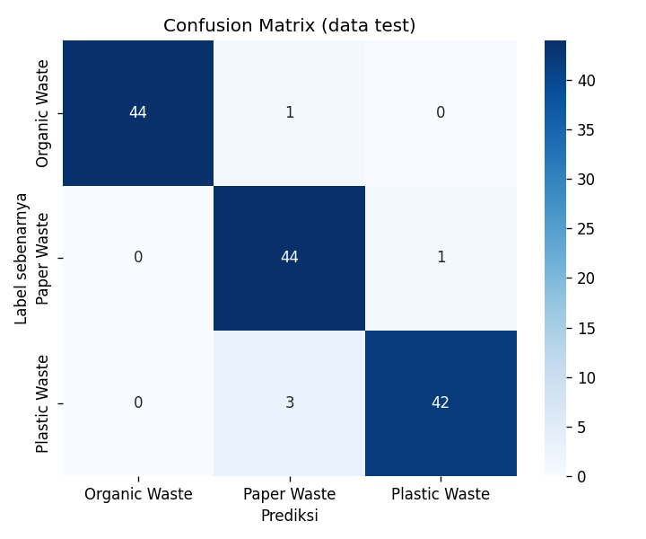

# Machine Learning: Klasifikasi Sampah

Model mengenali foto sampah menjadi 3 kategori: **Organic Waste**, **Plastic Waste**, **Paper Waste**.

- Model: MobileNetV2 (transfer learning + fine-tuning), TensorFlow/Keras
- Dataset: lihat [DATASET.md](DATASET.md)
- API: FastAPI, endpoint `POST /predict`

## Hasil evaluasi (data test)

> Isi bagian ini setelah training selesai (salin dari `results/classification_report.txt`).

| Metrik | Nilai |
|---|---|
| Test accuracy | 0.9630 |

File hasil: `results/confusion_matrix.png`, `results/classification_report.txt`,
`results/training_curves.png`, `results/metrics.json`.



## Struktur

```
ml/
├── notebooks/train_waste_classifier.ipynb   # training dan evaluasi (Google Colab)
├── app/main.py                              # REST API FastAPI
├── models/                                  # waste_classifier.keras, class_names.json
├── results/                                 # hasil evaluasi
├── requirements.txt
├── Dockerfile
└── DATASET.md
```

## Training ulang
1. Buka `notebooks/train_waste_classifier.ipynb` di Google Colab, pilih runtime GPU.
2. Jalankan semua sel. Unduh `ml_artifacts.zip` di akhir.
3. Ekstrak ke folder `ml/` (menghasilkan `models/` dan `results/`).

## Menjalankan API (lokal)

Python 3.10 sampai 3.12 (sesuaikan dengan versi yang didukung TensorFlow).

```bash
cd ml
python -m venv venv
venv\Scripts\activate          # Mac/Linux: source venv/bin/activate
pip install -r requirements.txt
uvicorn app.main:app --host 0.0.0.0 --port 8000
```

Dokumentasi interaktif (Swagger): http://localhost:8000/docs

## Dokumentasi API

### `GET /health`
```json
{ "status": "ok", "model_loaded": true, "classes": ["Organic Waste", "Paper Waste", "Plastic Waste"] }
```

### `POST /predict`
Body: `multipart/form-data`, field `file` berisi gambar (JPG/PNG, maksimal 8 MB).

```bash
curl -X POST http://localhost:8000/predict -F "file=@sampah.jpg"
```

Respons 200:
```json
{
  "label": "Plastic Waste",
  "confidence": 0.9421,
  "probabilities": { "Organic Waste": 0.0113, "Paper Waste": 0.0466, "Plastic Waste": 0.9421 }
}
```

| Kode | Arti |
|---|---|
| 400 | File kosong, bukan gambar, atau gambar rusak |
| 413 | Ukuran gambar lebih dari 8 MB |
| 422 | Field `file` tidak dikirim |

## Menghubungkan ke aplikasi mobile
Isi `mobile/.env`:
```
EXPO_PUBLIC_ML_API_URL=https://alamat-api-kamu
```
- Uji lokal: gunakan `ngrok http 8000` dan salin alamat `https://...` yang diberikan.
- Deploy: Hugging Face Spaces (SDK Docker) memakai `Dockerfile` di folder ini.
